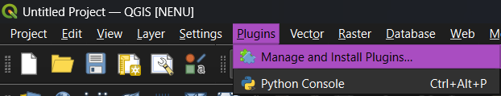
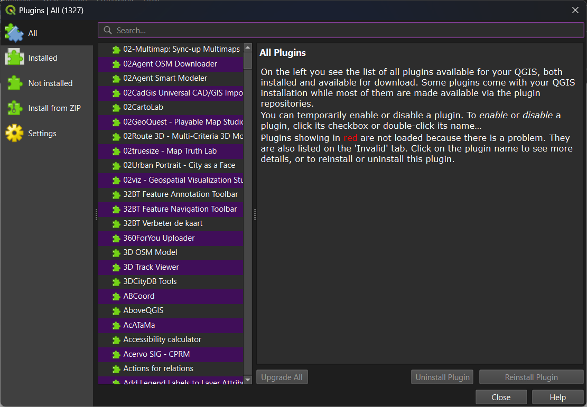
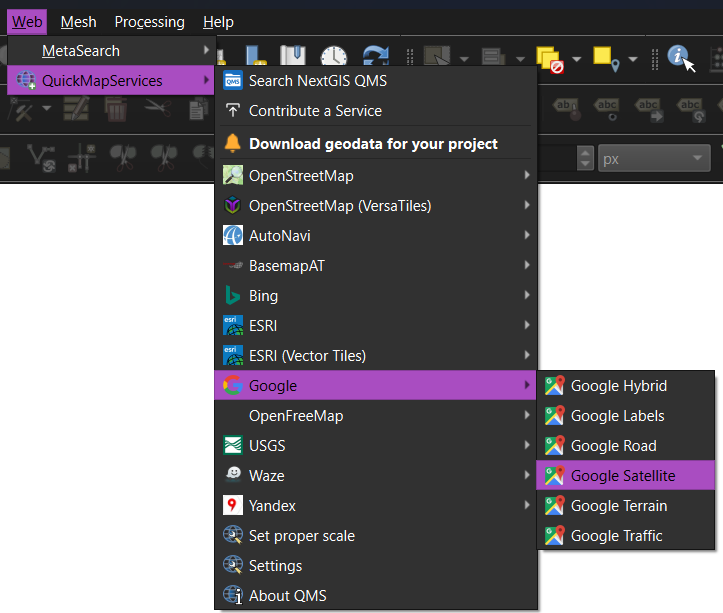
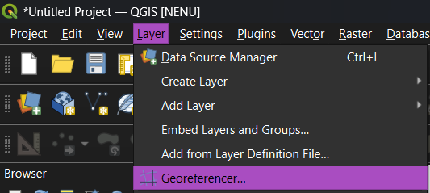
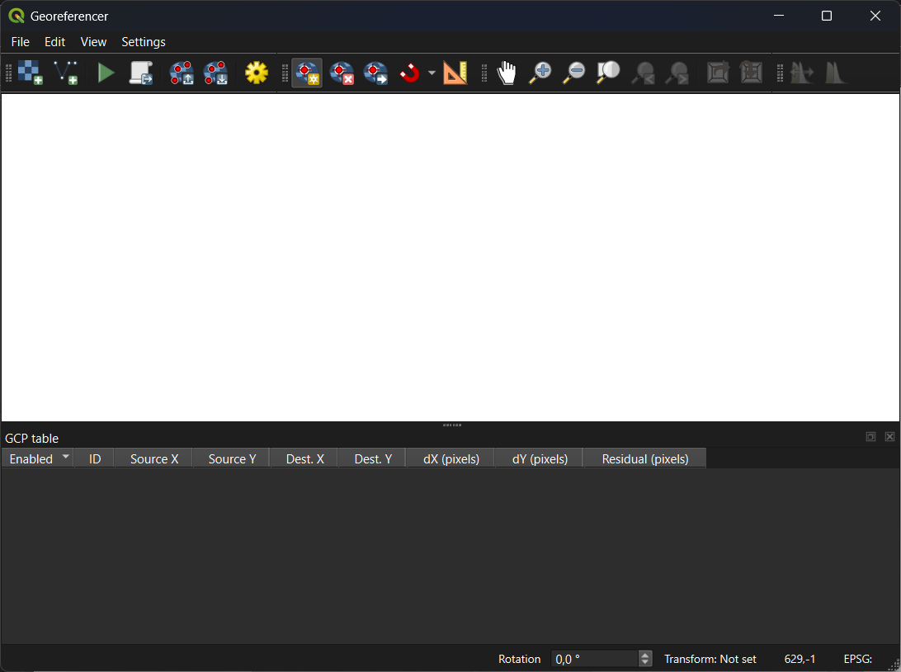
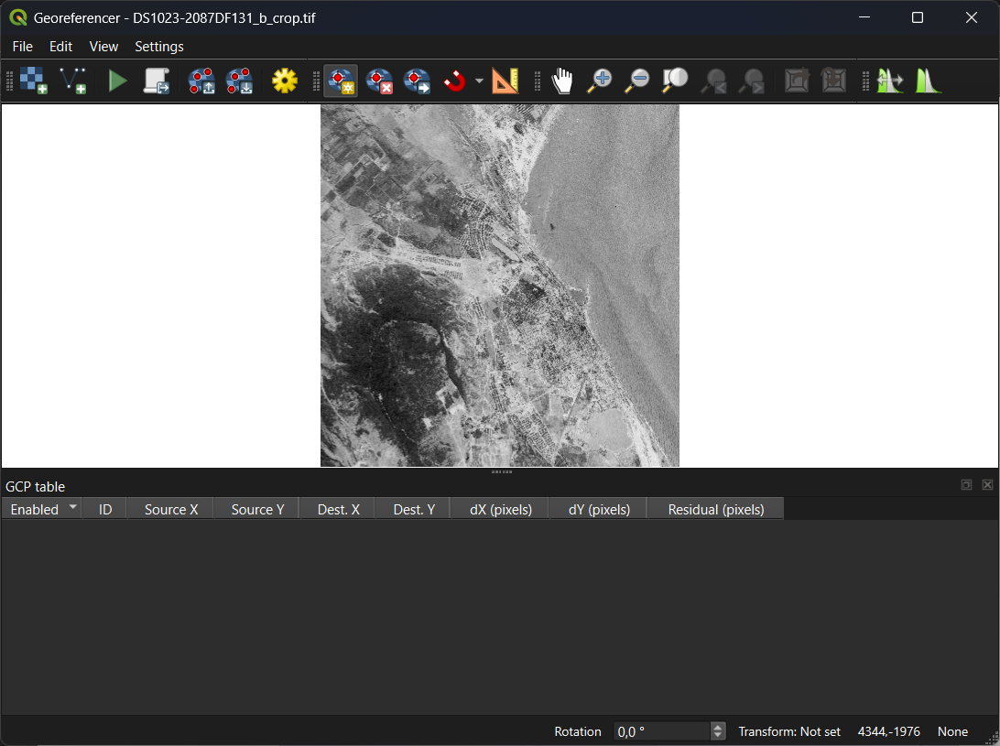
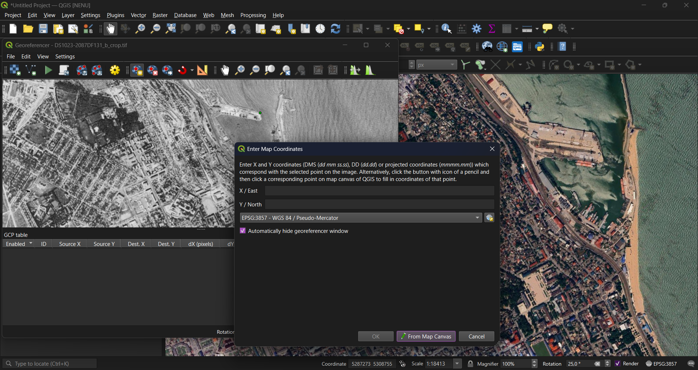
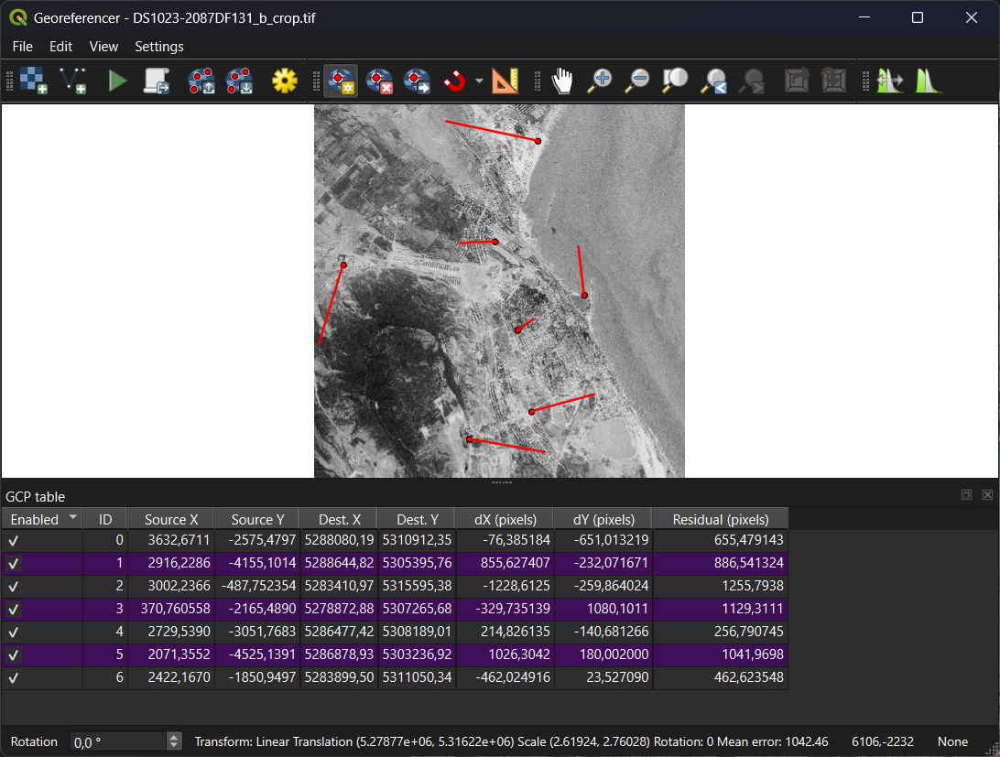
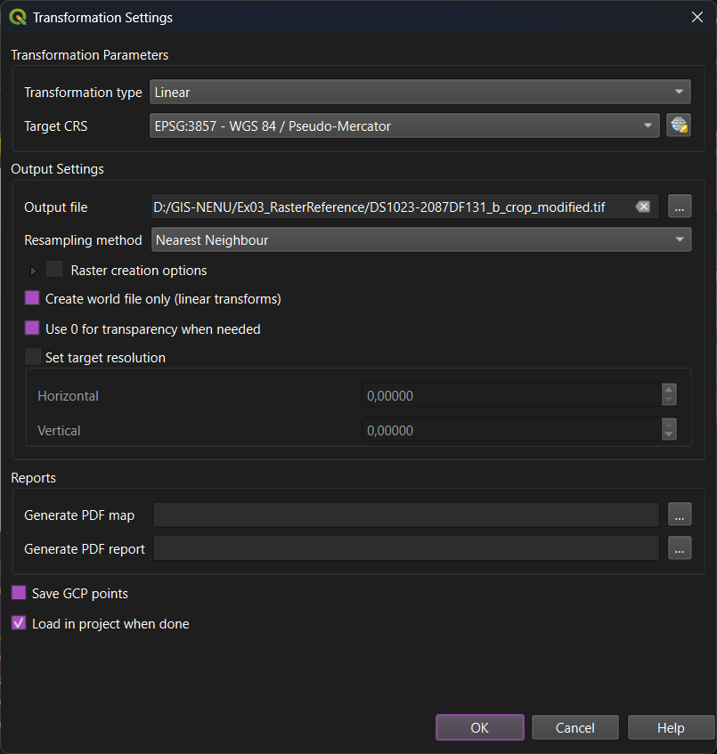

### Objectives

- Raster reference interface;
- Control points from map;
- Key in coordinates of control points;
- Raster georeferencing properties

### Key steps

- Installing plugins;
- Georeferencing raster to existing map;
- Georeferencing raster with direct coordinate key-in;
- Freehand raster referencing in QGIS.

### Input data for training

### Screenshots and additional information

#### Install plugins

To install plugins, navigate to "Plugins" — "Manage and Install Plugins...". You need Internet connection to install plugins from QGIS repository.

Find required plugin in the list of plugins, or start entering its name in "Search..." field at the top of 'Plugins' window.

We need a plugin which is called **NextGIS QuickMapServices**. It allows you to add some publicly available web maps into the project. A few new toolbars or panels can appear in QGIS after the installation. You may close them; turn them on when they are needed.

#### Add web map to QGIS

To add a map, navigate to "Web" — "QuickMapServices" and select a source to add. 

Web maps are not stored locally, you need an Internet connection for proper work.

#### Raster Georeferencing

Raster (and vector) georeferencing is located in "Layer" — "Georeferencer"

Add a raster to georeference via drag-n-drop or via `Open Raster` button

Click on raster in Georeferencer window to add a new ground contol point (GCP). You can enter coordinates manually or pick them from map canvas (`From Map Canvas` button).

Note that coordinates are entered with its CRS. You can then modify target CRS for referencing, and target coordinate number will be recalculated accordingly.

At a first attempt, there will be long red lines indicating error. Ingore them until you set a proper transformation.

Add as many GPSs as needed, click on `Transformation Settings` button and open settings window. Select proper transformation type and resampling method (not those which are shown below!).

After applying settings, red lines should become relatively small. Check if there are still some errors, correct or remove erroneous points.

When all point setting job is done, press `Start Georeferencing` button. A new georeferenced file will be created.

### Related pages from the QGIS training manual

Please note that these materials could be: 1) outdated; 2) sometimes inavailable from Russia.

- [QGIS Georeferencer Manual](https://docs.qgis.org/4.2/en/docs/user_manual/managing_data_source/georeferencer.html)