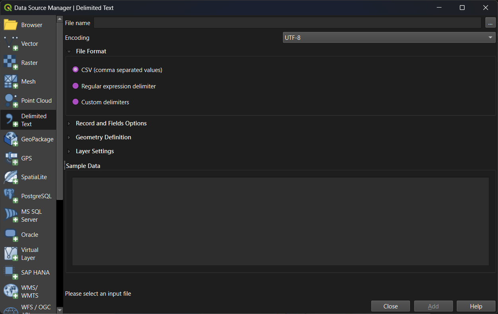
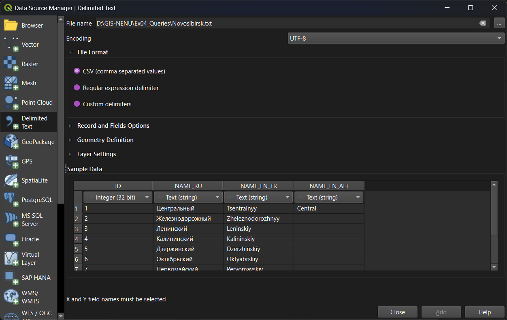
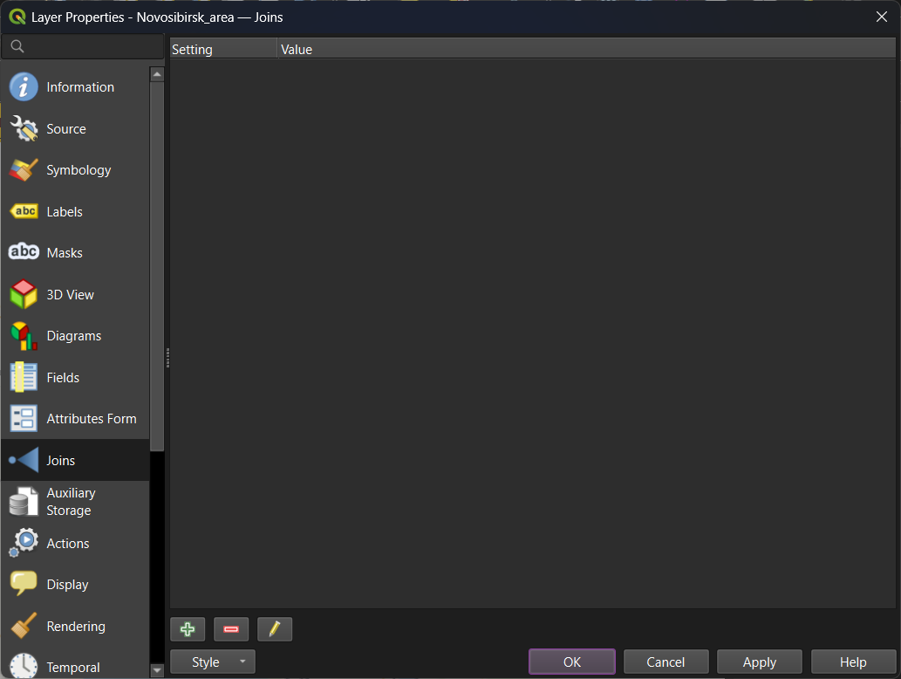
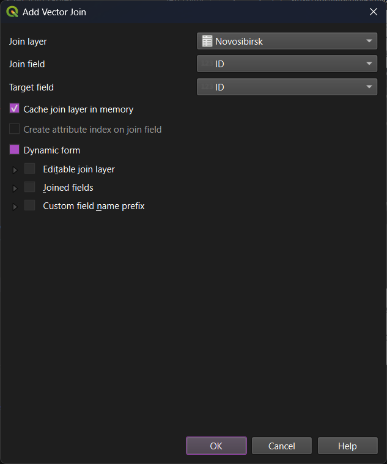
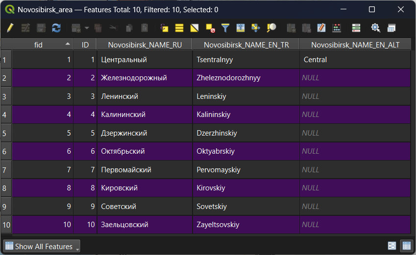
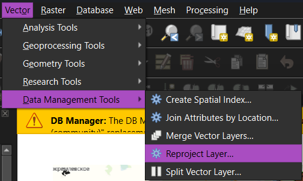
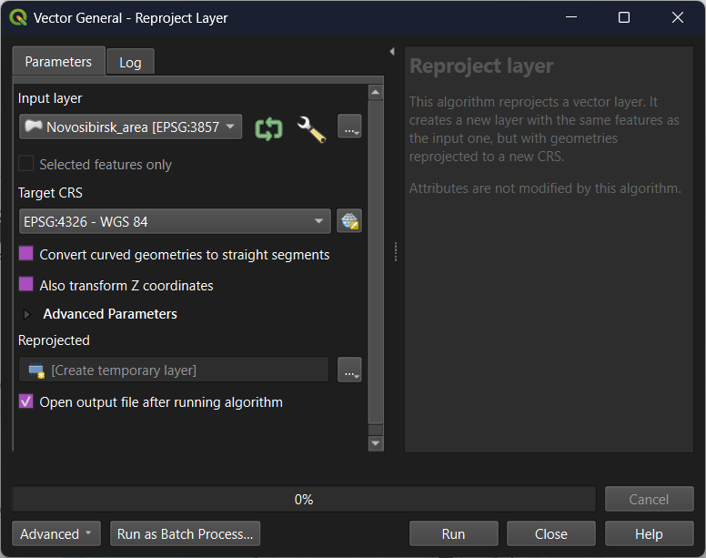

### Objectives

- Create a new GeoPackage;
- Digitize local areas;
- Add custom spreadsheet to the project;
- Join polygon data with external table;
- Reproject data;
- Perform attribute query;
- Perform spatial query;

### Screenshots and additional information

#### Add a spreadsheet to the QGIS project

Go to `Data Source Manager` – `Delimited Text`:

Browse for a file in the first row. Adjust settings, if necessary. Check if everything is good in the 'Sample data' form.

Press `Add` to add data to the project. The sheet will be added to the project.

`Delimited Text` interface allows for adding geometries described as point coordinates or WKT.

#### Join tables

To establish a temporary table join, do the following:

- check if there are key fields suitable for join in both tables (layers);
- open target layer properties;
- navigate to `Joins` section;

- press `Add New Join` button (green plus sign below)
- in the new window, set join layer (table), join field (primary key of the join layer) and target field (external key for join).
- adjust additional settings if needed.

- press `OK` to save join settings, then `Apply` or `OK` in the layer properties window.

The join is created. You can see the result when opening the target layer attibute table:

#### Reproject data

To reproject vector data, use `Vector` – `Data Management Tools` – `Reproject Layer`.

For this particular exercise, reprojection is not required: modern QGIS versions are able to perform spatial queries with different coordinate systems. Reprojection is needed in QGIS when you perform geometric operations between multiple raster or vector layers, or when it is necessary to make measurements and geometric operations in projected coordinate systems.

#### Attribute selection

#### Spatial query