### Objective

Calculate unilateral (one-sided) spatial association between soil subtypes and landform types

### Task description

Unilateral spatial association between two spatial datasets $A$ and $B$ is computed as

$\frac{|A \cap B|}{|A|}$

where $|A \cap B|$ is the area of intersection polygons between $A$ and $B$ entities, and $|A|$ is the area of $A$ entities itself.

To calculate unilateral spatial association in GIS, you need to:

1. Calculate area for each $A$ entity.
    1. Dissolve $A$ polygons by field that contains the relevant classes.
    2. Calculate geometry of the dissolved objects
2. Perform intersection between A and B.
3. Calculate area for each $A \cap B$ entity.
    1. Dissolve $A \cap B$ polygons by fields that contain relevant classes both from $A$ and $B$.
    2. Calculate geometry of the dissolved objects
4. Join tables two tables with the computed area (1 and 3) by $A$ class field, so all the area values will be combined in a single table.
5. Calculate spatial association by dividing area #3 by area #1.   

### Screenshots and additional information

#### Apply external layer style

In 'Layer Properties' window, find the button 'Style' below, press it and select `Load Style...` option

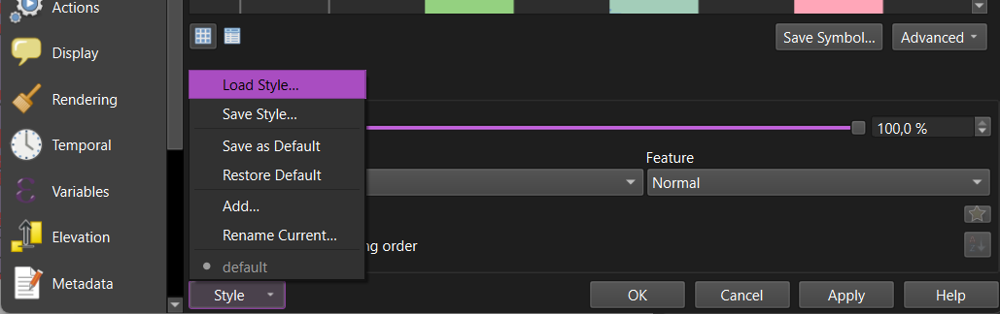

A 'Database Styles manager' will be opened. Find a style file (`*.qml` or `*.sld`) via `Browse` button, then select which style categories you want to import. Finally, press `Load Style`

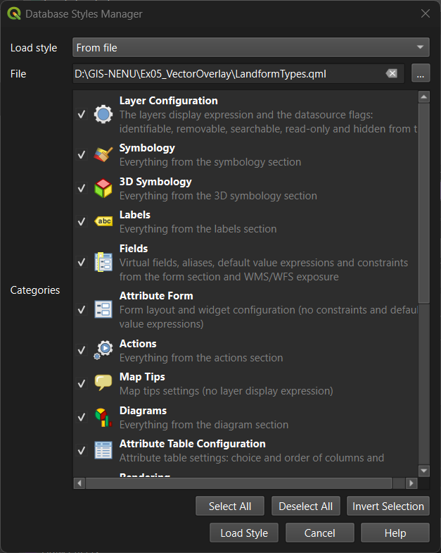

In the 'Layer Properties' window, press `OK` or `Apply` to apply new settings.

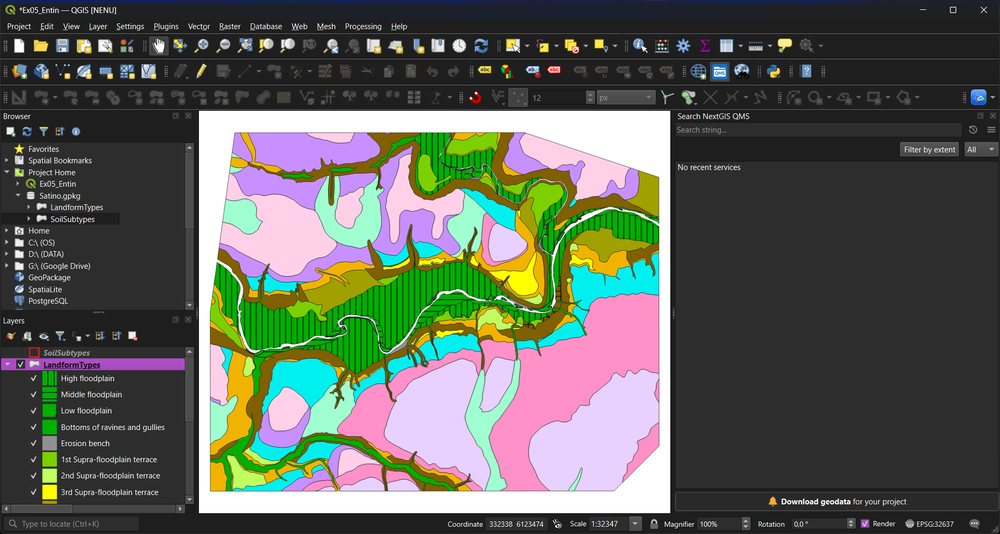

#### Dissolve layer

Dissolve operation allows you to combine all the layer features with the same attribute values (in some field or set of fields) in a single feature. For example, we have 'SoilSubtypes' layer with 283 features (rows):

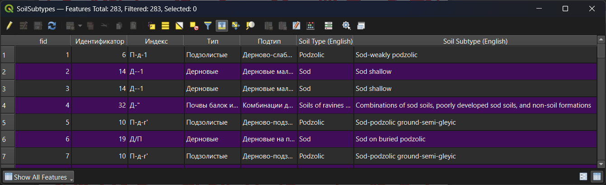

To perform dissolve, run 'Vector' – 'Geoprocessing Tools' – 'Dissolve...'

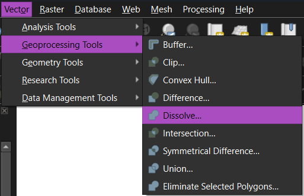

Set the layer you want to dissolve, and select dissolve fields

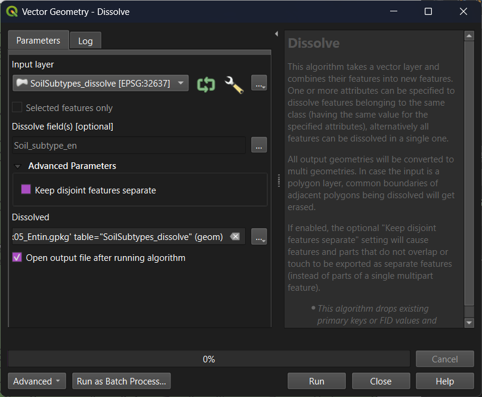

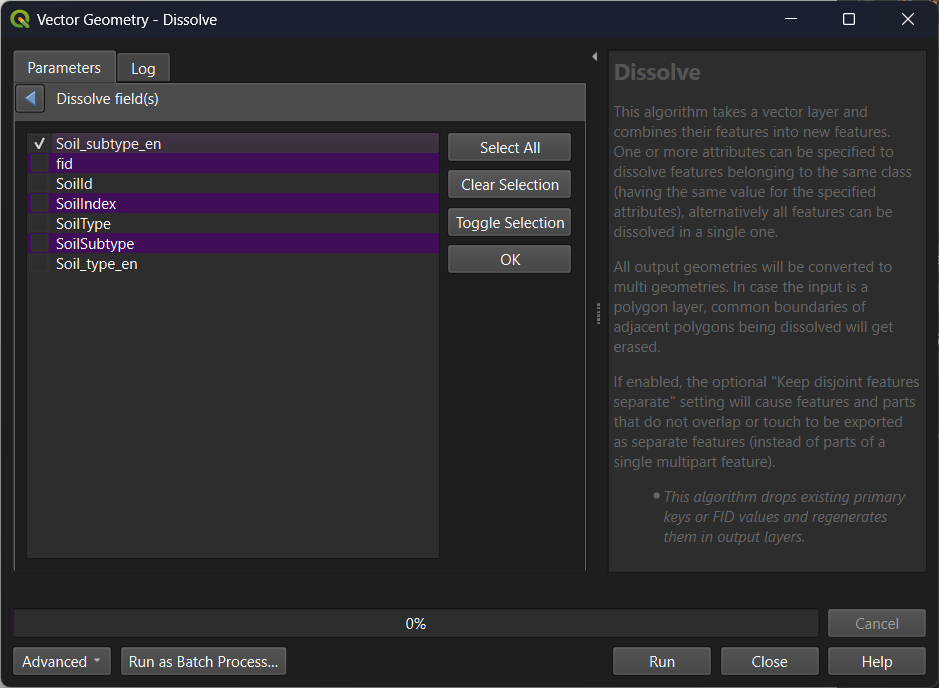

Press `Run` to run the instrument. The result of dissolve operation will contain less features than the input file, because all the features with the same values were combined to a single feature.

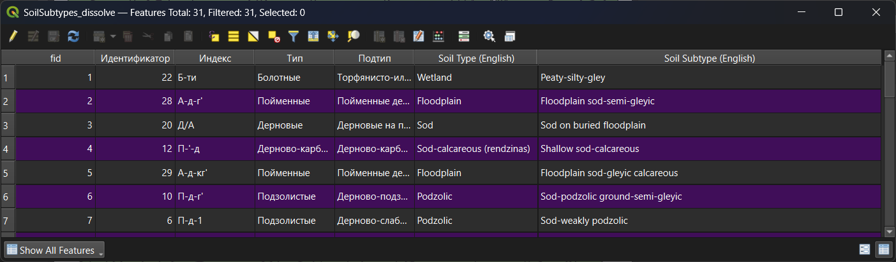

#### Intersect layers

To perform geometric intersection, run run 'Vector' – 'Geoprocessing Tools' – 'Intersection...'

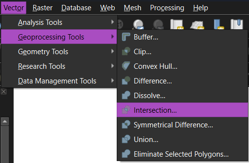

Set input and overlay layers, optionally set fields to keep.

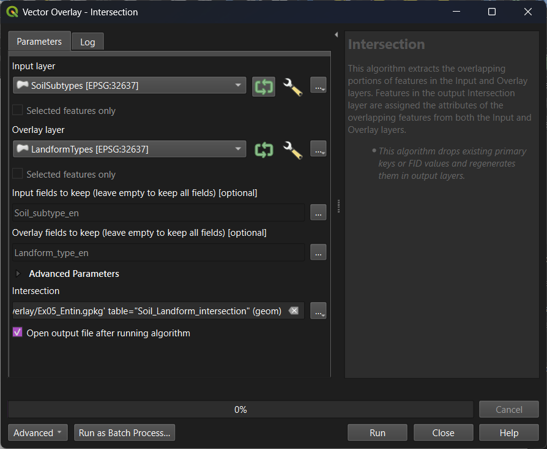

Press `Run` to run the instrument. Output layer contains a geometric intersection of the input features, and its attribute table condains both attributes from input and overlay layers, if any fields were selected.

#### Geometry calculation

A simplest way to calculate geometry attributes, such as area or perimeter, is to use 'Add Geometry Attributes...' instrument ('Vector' – 'Geometry Tools' – 'Add Geometry Attributes...').

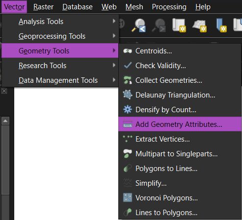

This instrument creates a new layer with geometry attributes.

Another way for calculating geometry attributes is to use Field calculator (see below)

#### Table join

To temporary join one table to another, open the target table's properties and navigate to 'Joins' section

*Note: a target table in QGIS is the table to which you are temporary joining some fields. The table which you adjoining is called simply 'join table'*

Click green plus button to add a new join. A window called 'Add Vector Join' will be opened.

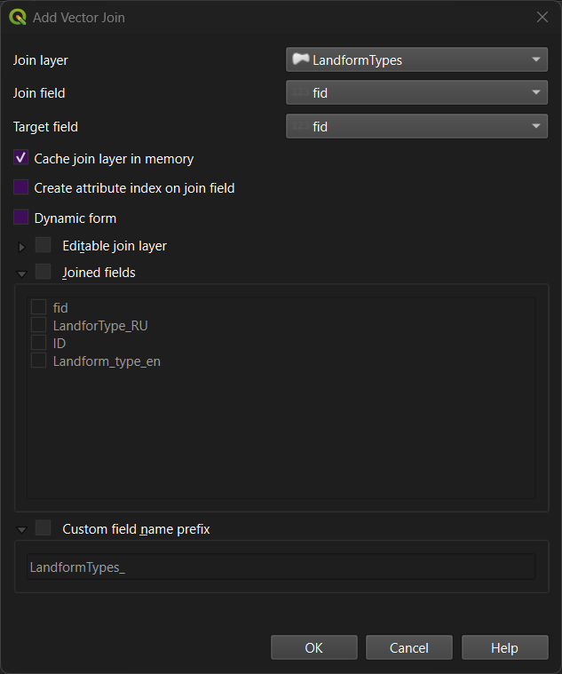

Select join layer (table), set join field and target field (external key). If necessary, customize other settings. Then press `OK`.

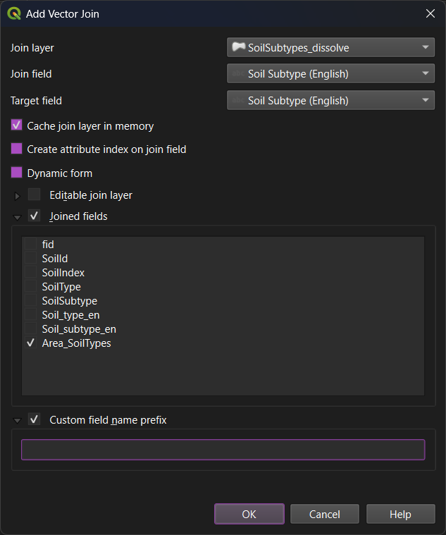

After applying the settings, selected fields from the join table will be temporarily added to the target table.

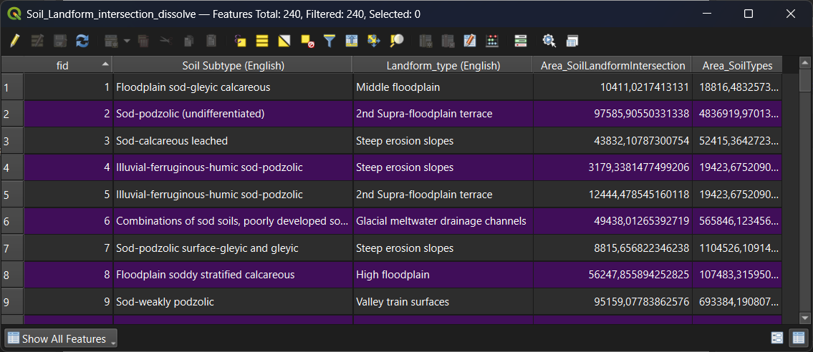

#### Field calculator

Field calculator is used to create new fields or modify existing fields by applying an expression. You can open Field Calculator from the Attributes toolbar in the main QGIS window, or from the attribute table toolbar in the attribute table window.

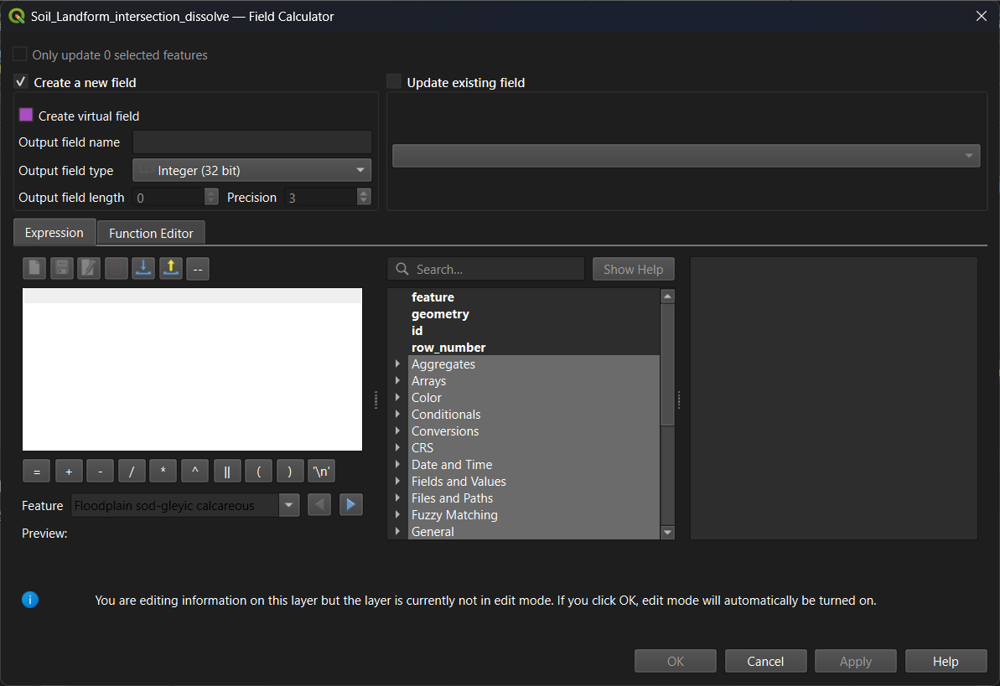

At the top of the Field Calculator window, there is a setting to specify where the result should be saved (either in a new field or an existing field). The left third of the window contains a form for entering expressions. In the middle, there is a section listing all available functions, as well as fields and values. The right side of the window features dynamic help. In particular, you can view a list of unique values ​​for a selected field there.

Enter an expression for the calculation and execute it. When performing a calculation, the layer automatically switches to edit mode; remember to toggle off editing once the calculation is complete.

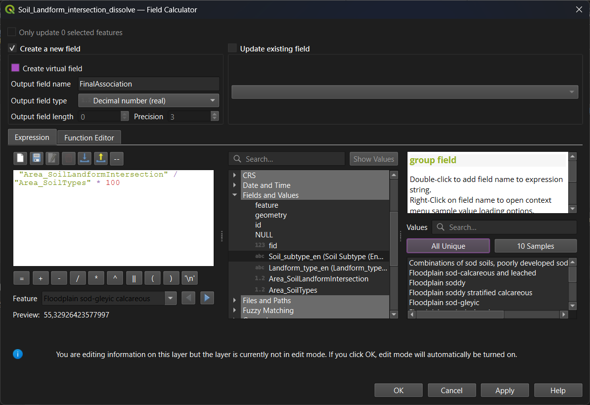

The Field Calculator also allows the use of built-in functions for calculating geometry attributes. In particular, `$area` functions calculates an ellipsoidal area of the feature.