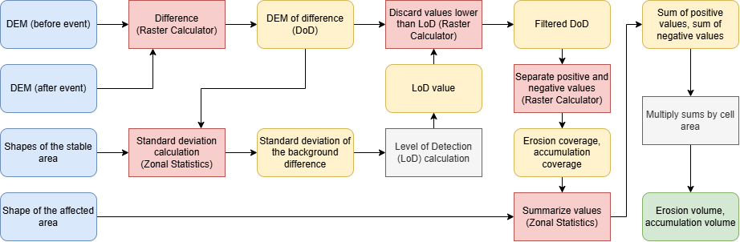
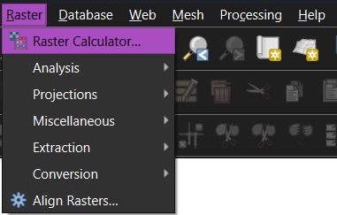
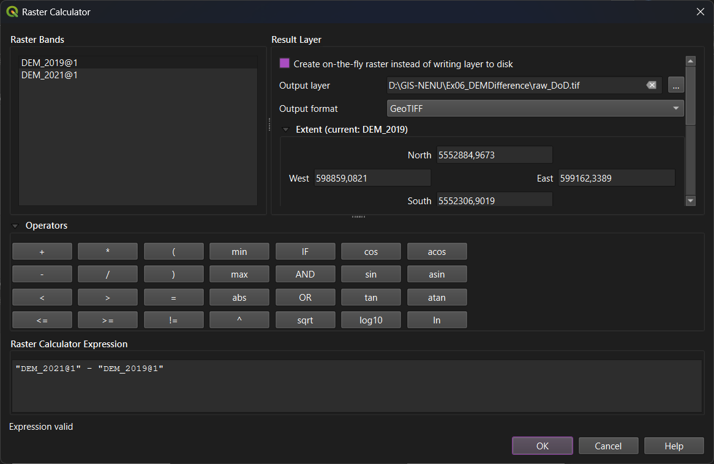
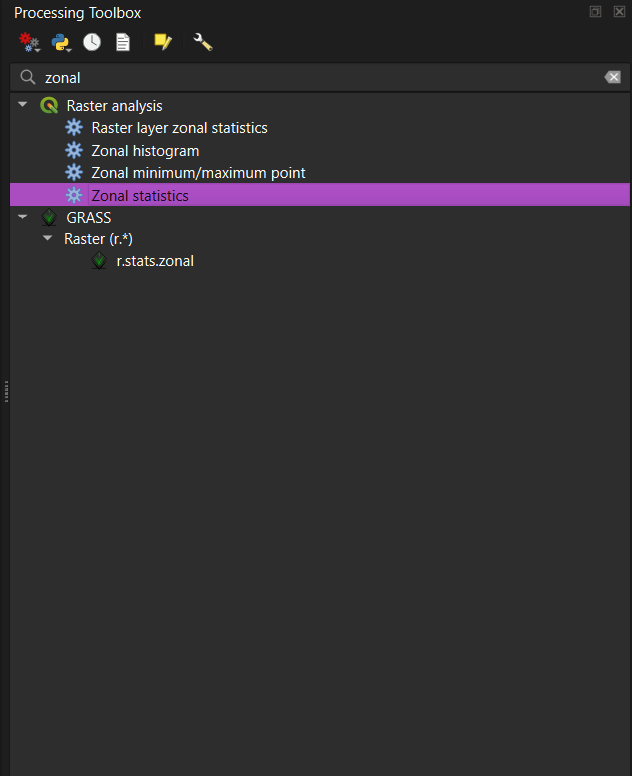
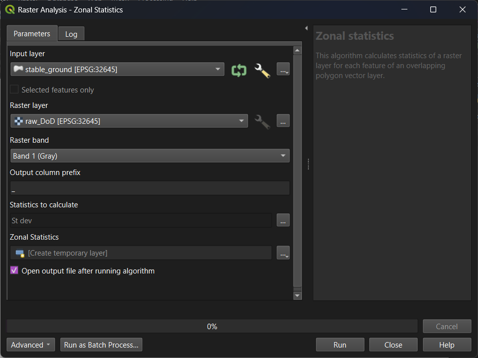

### Objective

Calculate the volume of material erosion and accumulation at the site after a landslide event.

### Task description

If you have two digital elevation models (DEMs) representing the state of the terrain before and after changes, you can calculate elevation difference resulting from these changes; then, by using the sum of these differences and cell size, you can determine the volume of erosion and accumulation. For an accurate calculation, you will need two additional datasets: the outline of the area subject to change ((multi)polygon), and the outline of an area known to remain unchanged ((multi)polygon).

To perform the analysis, do the following:

1. Calculate difference between two DEMs with Raster Calculator. The resulting dataset is usially called *DEM of Difference*, or *DoD*.

2. Exclude from the DoD areas where changes are more likely to be associated with noise in the models rather than with actual changes on the ground. To do this, determine the *Level of Detection* (*LoD*). The LoD is typically defined as the 95 % or 99 % confidence interval for the statistics of the differences within areas assumed to be stable. In practical terms, it can be calculated as follows:

    1. Digitize the conditionally stable regions as a large polygon or multipolygon.

    2. Calculate Zonal Statistics of DoD within this (multi)polygon. You need the only statistics - a standard deviation ($\sigma$).

    3. $1\sigma$ covers approximately 68 % of difference values. To get 95 %, multiply $\sigma$ by $1.96$. To get 99 %, multiply $\sigma$ by $2.58$. This will be your LoD.

3. Set DoD cells with values lower than LoD to NoData. This can be done with Raster Calculator.

4. Use filtered DoD to create two new rasters: erosion raster (values > 0) and accumulation raster (values < 0).

5. Digitize affected area polygon.

6. Use affected area polygon to summarize erosion and accumulation changes (separately). Apply Zonal Statistics for this operation.

7. You now have sums of the positive and negative difference values. Multiply them by the cell size to obtain final volumes.

The sequence of actions is shown in the diagram below.

### Screenshots and additional information

#### Raster calculator

There are multiple Raster Calculator instruments in QGIS. A QGIS's own solution can be found in 'Raster' – 'Raster Calculator' 

At the upper-left side, there is a list of available rasters. At the upper-right side, you can manage output settings. The bottom part is taken by raster operators and the form to enter the exrpession for calculation. 

A few expression examples:

* `"A@1" - "B@1"` – difference between rasters A and B. `@1` stands for the first band of the raster.
*  `if ( "A@1"> 0, 1, 0)` – condition evaluation. The resulting raster cell will have $1$ if the raster A's cell value is greater than 0 (condition value is `True`), $0$ otherwise (condition value is `False`).
* `if ( "A@1"> 0, 1, 0/0)` – the same condition, but the false result will be NoData. Unfortunately, there is no direct operator of NoData assignment in QGIS raster calculator, so we surrogate it with `0/0` expression.

#### Zonal Statictics

Zonal Statictics can be found in 'Processing Toolbox' panel. Use text search to find the instrument.

In this instrument, you set input zone layer (polygons or multipolygons), input raster layer, and the band number of the input raster. Also you can choose statistics to calculate and customize field prefix for the calculation result. 

The result is stored in a new vector dataset with the same geometry as the input zone layer. This new dataset contains calculated zonal statistics for each input object.
