## Objective

Select the optimal location for an industrial site based on a combination of indicators that characterize various factors of suitability.

## Task description

In this work, you will select a site for an industrial facility using spatial data and GIS-analysis. You will consider four factors: local terrain slope, proximity to roads, proximity to water sources, and current land use on the site. Each of these four factors will be represented as an indicator. The indicator values will then be reclassified into scores–except land use, where scores will be assigned directly. After reclassification, you will perform a weighted overlay to obtain a final score. Finally, you select site(s) with the highest score, if its (their) area is large enough for industcial facility placement.

A scheme of the processing is shown below:

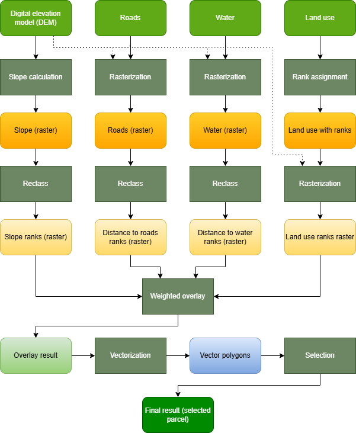

## Computation details and screenshots

### Local terrain slope

Local terrain slope is formalized by slope angle. It can be derived from digital elevation model ('Raster' – 'Analysis' – 'Slope...').

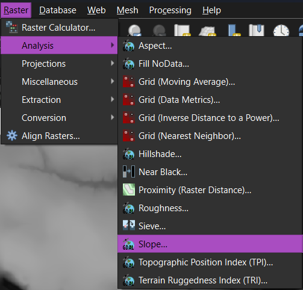

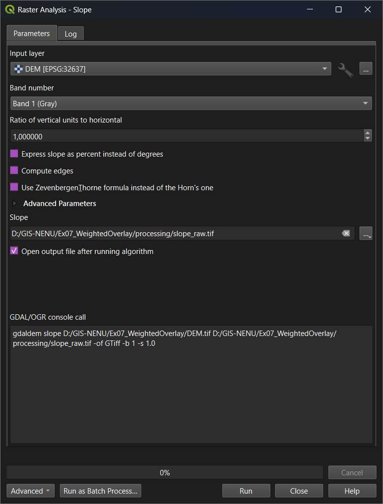

### Proximity to roads

Proximity to roads can be derived from the road network. First, you need to select roads suitable for industrial purposes. Then, you need to convert these roads from vector to raster ('Raster' – 'Conversion' – 'Rasterize (Vector to Raster)...'). Note that in QGIS you need to explicitly indicate output raster properties (units, extent, and cell size) for conversion. 

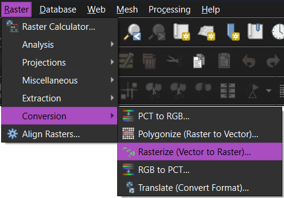

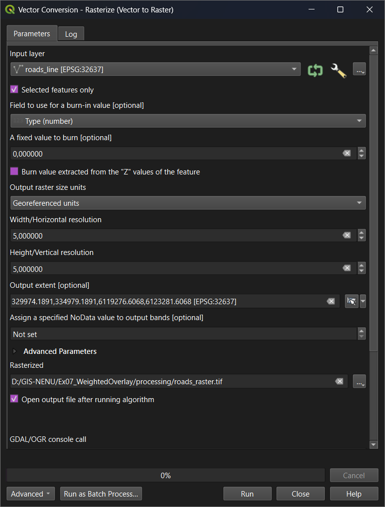

Finally, you can derive proximity raster from roads raster ('Raster' – 'Analysis' – 'Proximity (Raster Distance)...'). Note that the proximity should be derived in map units, not in pixels.

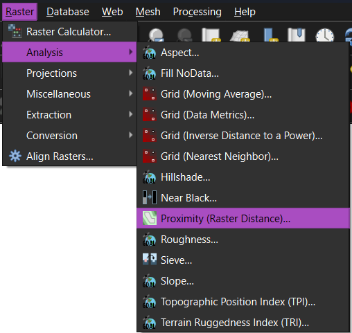

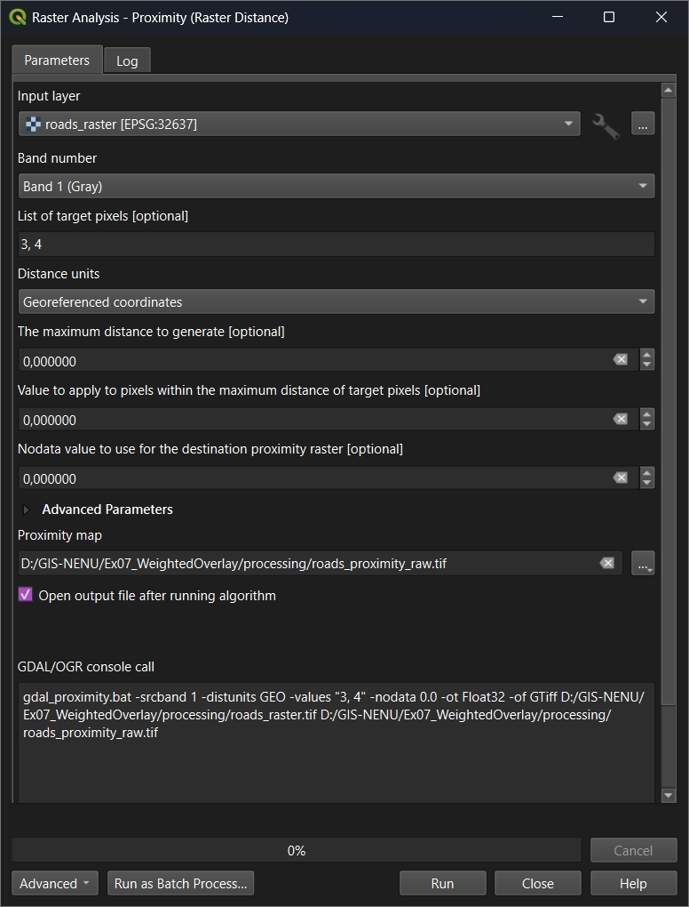

### Proximity to water 

Proximity to water is determined in the same way as proximity to roads. Select the relevant water features, convert them into a raster (don't forget to set the raster geometry parameters!), and calculate the proximity.

### Reclassification

Slope angle, proximity to roads and proximity to water should be reclassified for further application in a weighted overlay procedure. To perform reclassification, use `Reclassify by table` or `Reclassify by layer` instrument from the Processing toolbox.

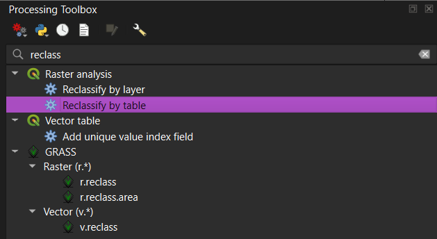

`Reclassify by layer` instrument requires a layer (a table) with classification:

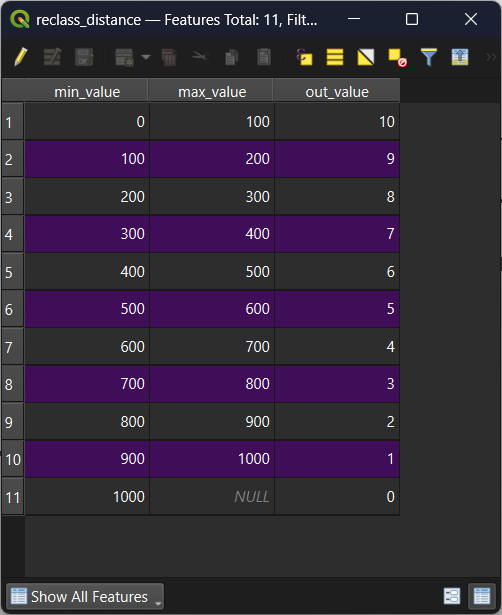

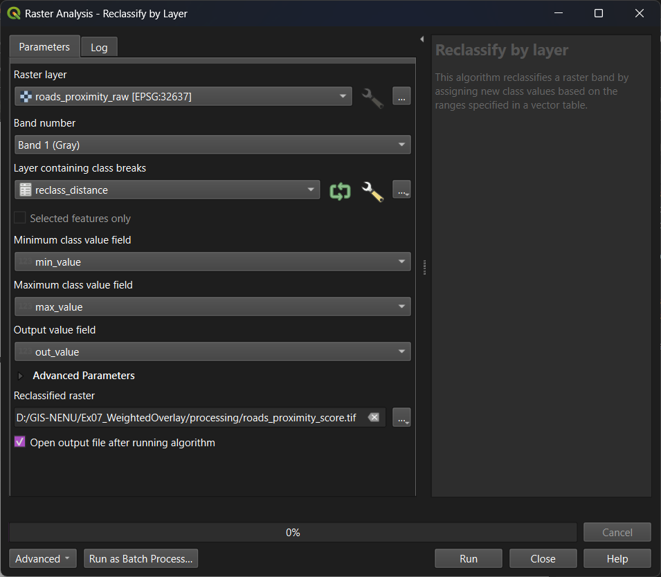

Use this instrument to reclass proximities ($d$) in such a way:

1) 0 < $d$ ≤ 100 → 10
2) 100 < $d$ ≤ 200 → 9
3) 200 < $d$ ≤ 300 → 8
4) 300 < $d$ ≤ 400 → 7
5) 400 < $d$ ≤ 500 → 6
6) 500 < $d$ ≤ 600 → 5
7) 600 < $d$ ≤ 700 → 4
8) 700 < $d$ ≤ 800 → 3
9) 800 < $d$ ≤ 900 → 2
10) 900 < $d$ ≤ 1000 → 1
11) 1000 < $d$ ≤ ∞ → 0

Instead of $∞$, you can use a value that is greater than the maximum proximity in your input rasters.

`Reclassify by table` instrument allows you to set the table for reclassification as a parameter. Use it to reclass slope angle according to the table below:

|\#|Slope, °|Score   |
|--|--------|--------|
|1 |0–3     |       9|
|2 |3–6     |      10|
|3 |6–9     |       8|
|4 |9–18    |       6|
|5 |>18     |*NoData*|

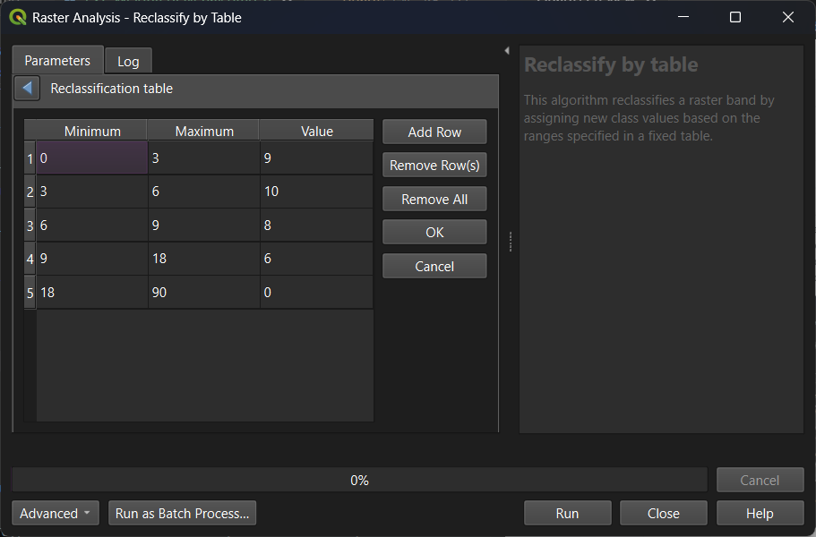

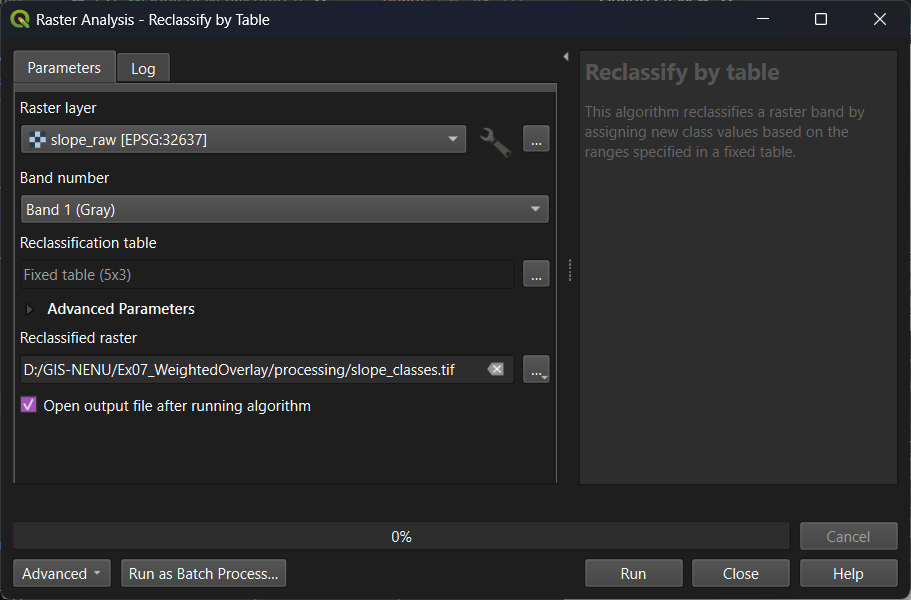

### Land use

Land-use type is a nominal variable, so we directly assign a score for each land type. Scores are listed in the table below:

|\#|Land_type       |Score|
|--|----------------|-----|
|1 |arable land     |    4|
|2 |farm            |    2|
|3 |forest          |    3|
|4 |forest clearing |    2|
|5 |forest glade    |    5|
|6 |garden          |    2|
|7 |hydrography     |    0|
|8 |meadow          |    8|
|9 |pasture         |   10|
|10|roads and trails|    1|
|11|settlement      |    3|
|12|wetland         |    0|
|13|No data         |    0|

To assign the score, create a new field and use Field Calculator. There are multiple techniques to assign desired values. For example, you can sequentially select every single land type and then assign scores to the selected features. An alternavie is to use `CASE` construction: 

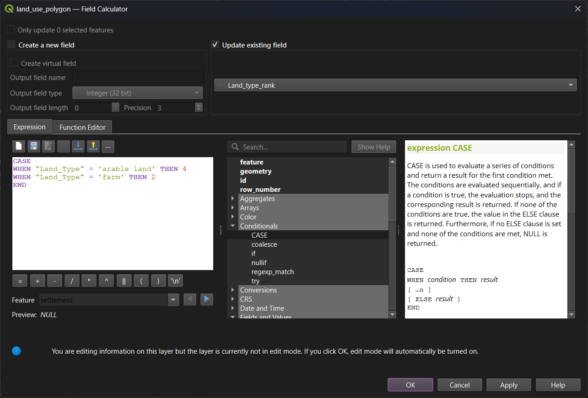

When scores are assignment, use rasterization instrument (see above) to obtain raster of land type scores.

After the conversion, check your output raster coverage. It should look like the image below

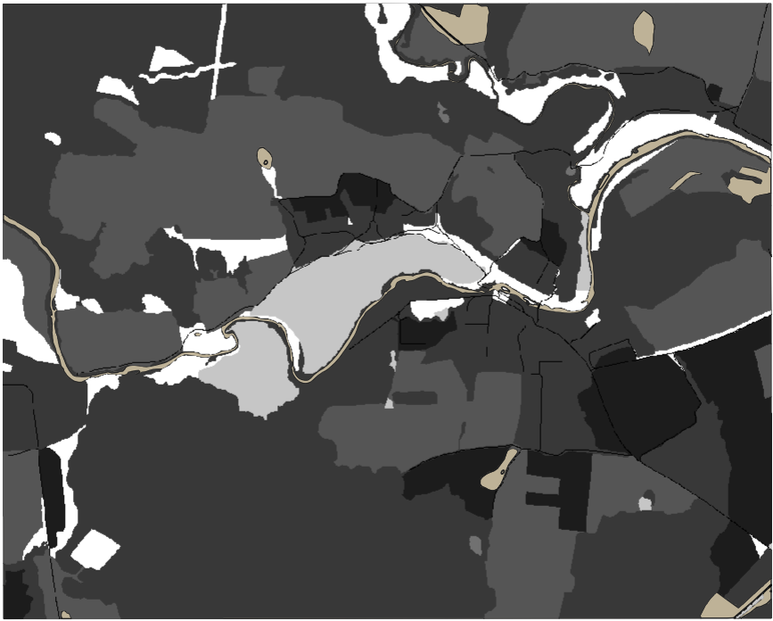

If there are too many `NoData` cells, as displayed below, **IT'S A BUG!!!**: for some reason, the rasterization tool does not always work correctly with GeoPackage. 

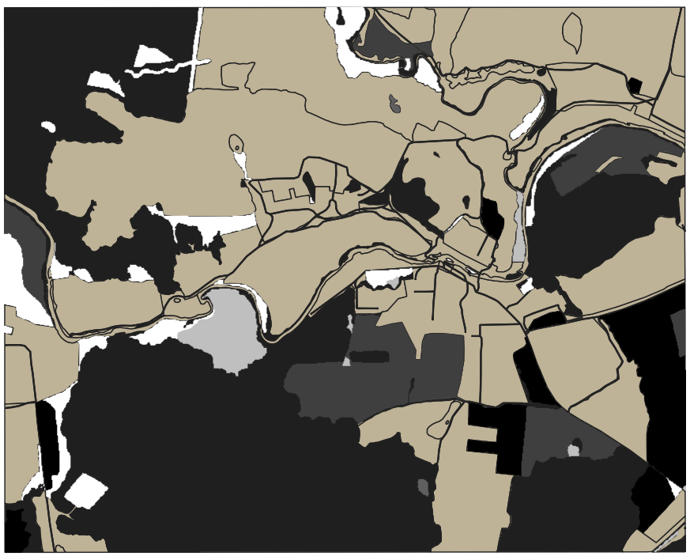

In this case, do the following: export the `Land_use_polygon` layer to a shapefile, then use that shapefile for the rasterization process.

### Weighted overlay

When all the classified rasters are ready, perform the weighted overlay. Multiply your ranks with the weights defined below:

|\#|Factor|Weight, %|
|--|------|---------|
|1 |Slope |       15|
|2 |Roads |       35|
|3 |Water |       20|
|4 |Land  |       30|

Then sum the obtained values ​​and round the result to the nearest whole number. 

All these operations can be conveniently performed using a single tool: the Raster Calculator. However, this is not the same Raster Calculator tool you are already familiar with. Rather, it is recommended to use a tool from the GDAL library, which can be found in the Processing Toolbox.

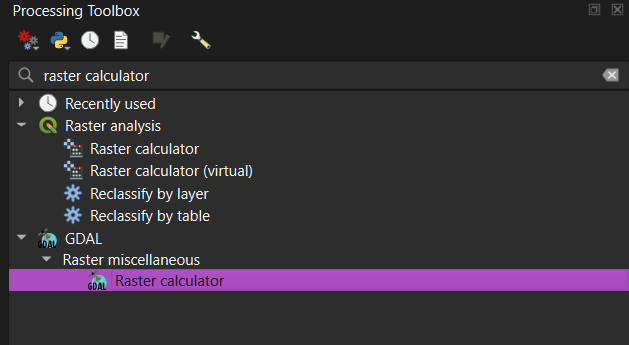

In this instrument, you indicate input rasters with Latin alphabet symbols, such as `A`, `B`, `C`...

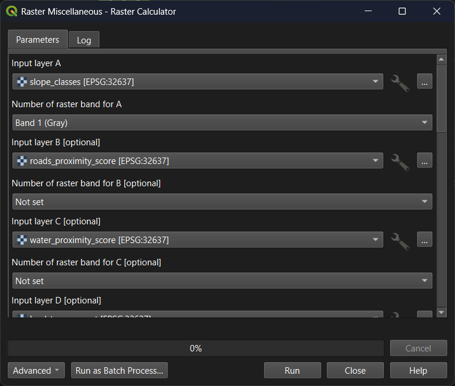

There is a `Calculation in gdalnumeric syntax...` field where you can write your calculation expression, such as:

`A*0.1 + B*0.2 + C*0.3`

Note that there you can use Python synthax and functions, e.g. `round()`.

Also note that this instrument allows you to set output raster type, such as Byte, UInt, Float and so on.

The result of weighted overlay is supposed to look like this:

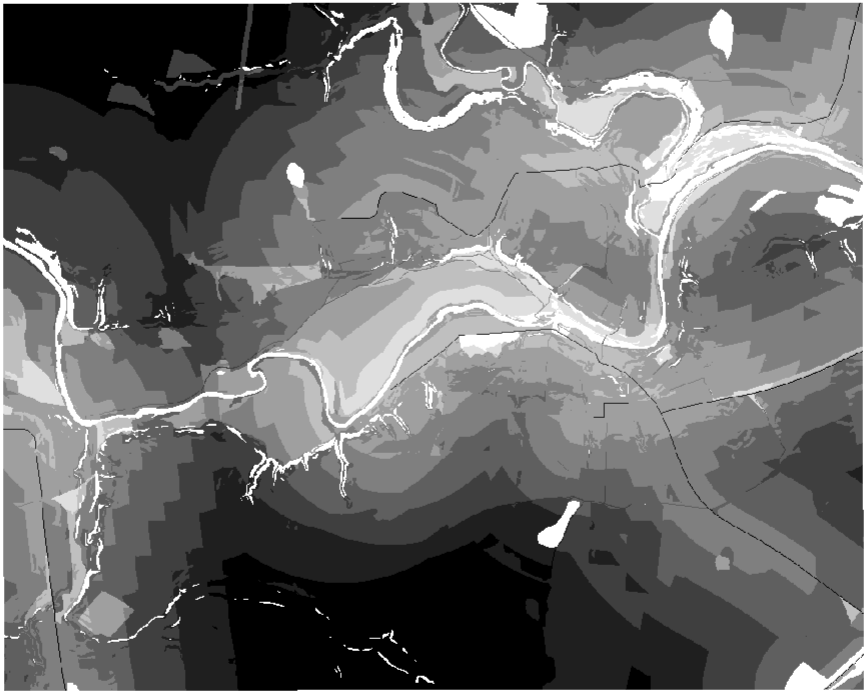

### Final parcel selection

After you got the weigthed overlay result, convert it to vector polygons ('Raster' – 'Conversion' – 'Polygonize (Raster to Vector)...')

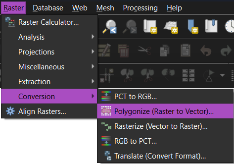

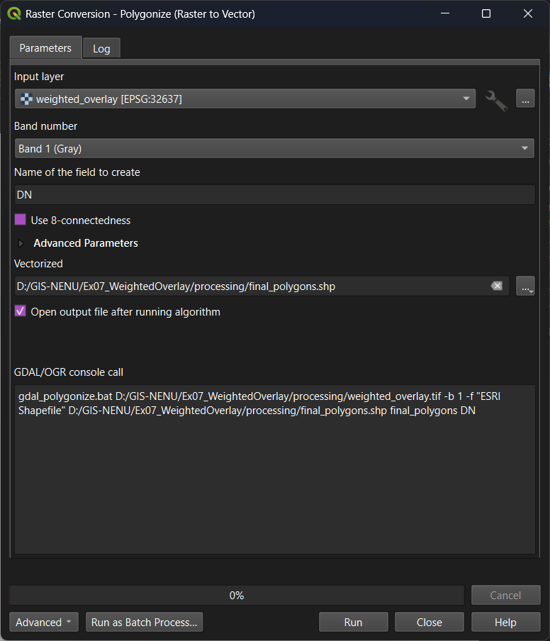

Once you have obtained the vector polygons, use a conditional selection ('Select by Expression') to select polygons with the highest rank whose area exceeds the required threshold. For example, here is the result of such a selection using an area threshold of *2 hectares* (*20 000 sq. m*):

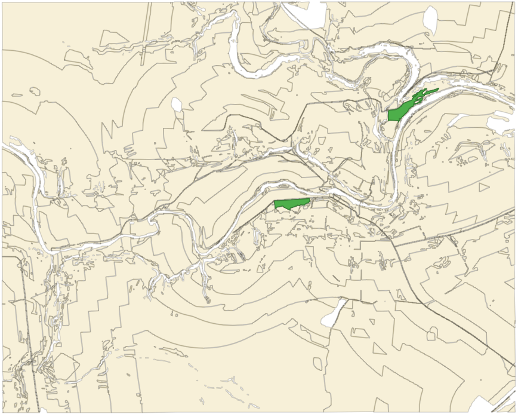
