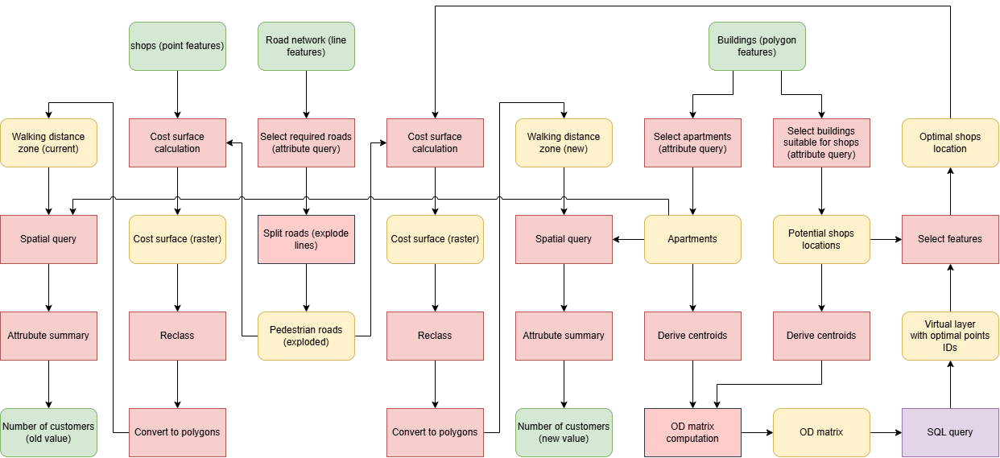
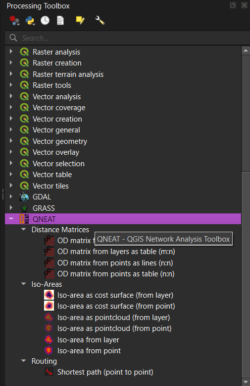
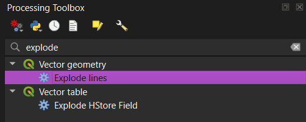
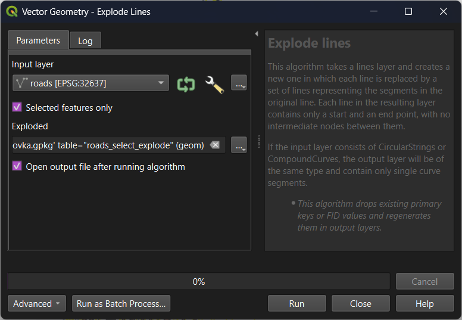
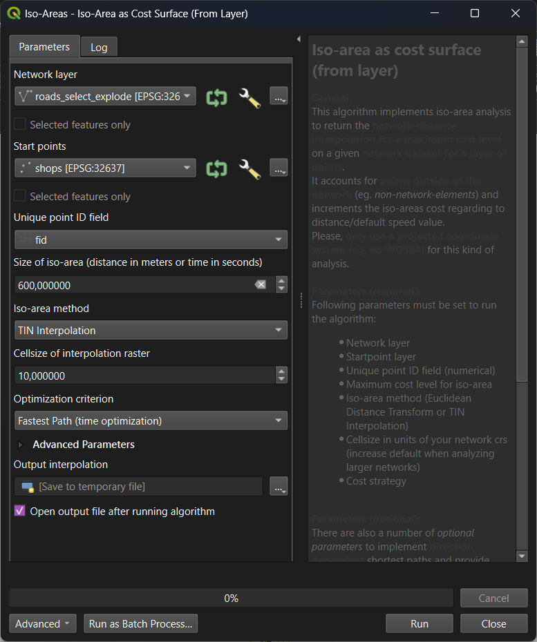
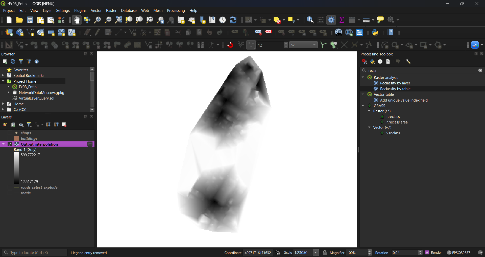
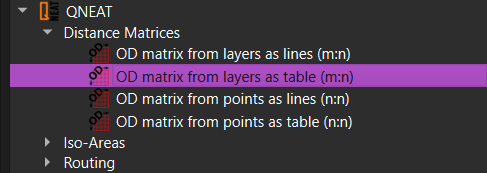
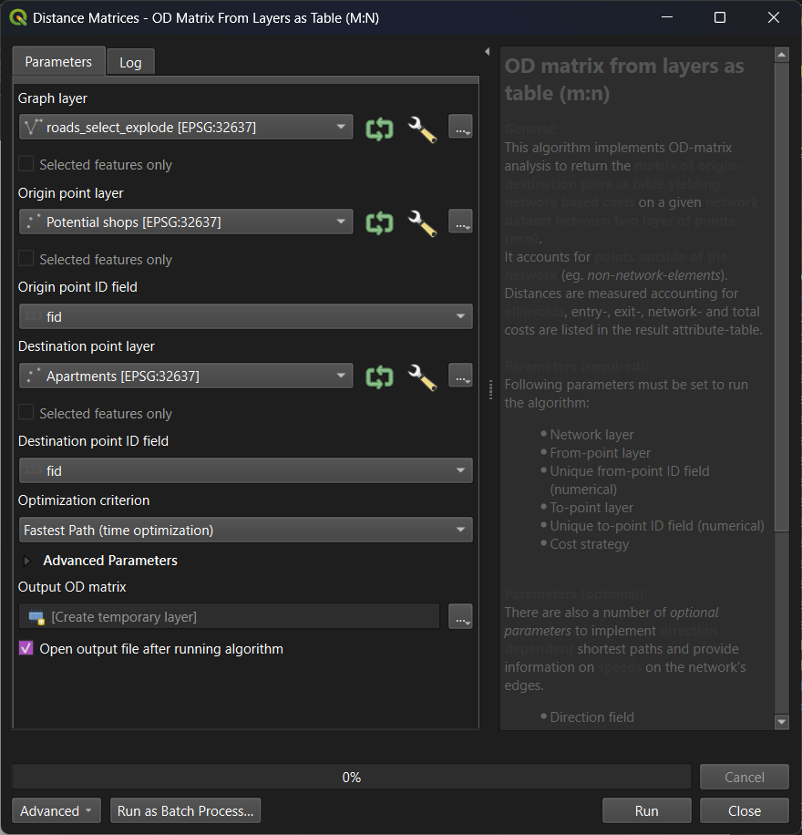
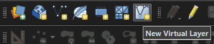
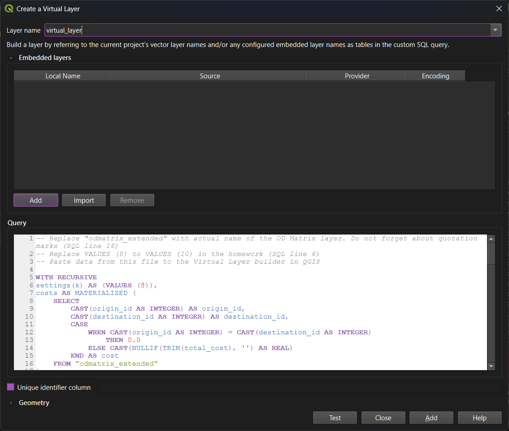

## Objective

Find optimal locations for shops within a selected administrative district of Moscow.

## Task description

In this exercise, you will learn the basics of network (transport) modeling in GIS. You have been provided with data on apartments (including their approximate population), road network, and everyday convenience shops in a certain district of Moscow. Using network analysis tools in QGIS, delineate the 10-minute walking distance zone around shops, then calculate the population size within this zone. Next, derive potential locations for shops allocation. These potential locations correspond to buildings of specific classes. When you have points representing potential locations, calculate the origin-destination matrix (OD matrix) from these locations to apartments. Using this matrix and the provided SQL script, determine which locations would offer the best accessibility if shops were to be established there. To ensure that the proposed locations offer better accessibility than the existing ones, delineate walking distance zone again and calculate the population within the new zone.

There are several specific aspects to consider when performing these operations. 

Concerning **all input data**: 

Crop data to the district border before analysis.

Concerning **road network**: 

1. From the entire road network, it is necessary to select only those features that correspond to pedestrian routes. These include: `footway`, `path`, `pedestrian`, `steps`, and `service`. 
2. The dataset provided to you is partitioned into several connection components. Include an additional selection condition (`"component_id" = 0`) to select only the connected component with the minimum index.
3. An "Explode lines" operation must be performed on the selected road network features. This operation ensures that the lines are broken at the connection nodes.

Only after these operations will you have a road network suitable for calculating pedestrian routes.

Concerning **buildings**:

1. Only the `apartments` class should be used when counting population 
2. Only the `apartments` class should be used as destination for OD matrix computation
3. Only the following classes are suitable for shop allocation: `apartments`, `commercial`, `office`, `retail`, and `store`.

Concerning **walking distance zone**:

Calculating the pedestrian accessibility zone will involve several steps. Calculating the pedestrian accessibility zone involves several steps. First, calculate an "Iso-Area as Cost surface" (a coverage raster where each cell represents the distance or travel time from the nearest source to that specific location). Then, reclassify this raster into a binary raster such that all values ​​below the required threshold are assigned a new value of 1, while all other values ​​are set to "NoData". After that, convert the classified raster into a vector polygon.

Concerning **optimal location determination**: 

Optimal location is determined by a greedy algorithm which does not have direct implementation in QGIS. To simulate it, we will first construct an OD matrix (as a representation of the set of all paths) and then apply a specific SQL query to determine the optimal values ​​based on that matrix.

An almost-full scheme of the processing (excluding initial data clipping) is shown below:

## Required plugins

The **QNEAT** plugin is required for this exercise. QNEAT implements network analysis operations in QGIS.

QNEAT can be installed directly from plugins window. After installation, QNEAT instruments are available from Processing panel:

## Computation details and screenshots

### Explode lines

"Explode lines" is necessary to ensure that lines are broken at points of connection or intersection. Without this, the algorithms built into the QNEAT module will not work.

Select necessary roads, explode them, and save results to a permanent dataset. This dataset will serve as a base for further network analysis.

### Calculate cost surface

Cost surface can be calculated with 'Iso-Areas as Cost Surface (from layer)' instrument. Indicate network layer (lines) and source points. Set size area to 600 seconds, Iso-area method to TIN interpolation and optimisation criterion to fastest path. 

Cost surface is a raster in which each cell contains the travel distance (or time) from the nearest source point to that cell.

Cost surface raster can be reclassified, then vectorized to obtain an accessibility zone.

### Calculate OD matrix

Origin-destination (OD) matrix can be calculated with 'OD Matrix from Layers as Table (M:N)' instrument. Set network graph layer (lines), origin points and destination points. Specify optimization criterion (fastest path)

Output OD matrix is a **table**. We need it to determine optimal shop locations.

### Choose optimal locations

There is no special instrument to perform an algorithm for location selection. To get around this problem, we have prepared a special solution. The solution is to create a virtual layer using an SQL expression.

 > A *virtual Layer* in QGIS is a special type of vector or non-spatial layer created dynamically from the results of an SQL query. The query is run on one or more layers already loaded in a project.

To create a virtual layer, do the following:

1. Click 'New Virtual Layer' button in the Data Source Manager toolbar:

2. When 'Create a Virtual Layer' window opens, copy and paste SQL query to the 'Query' form below:

3. Replace the "odmatrix_extended" table name in the line 16 with your actual OD matrix table name.

4. *(only for homework)* Replace `VALUES(8)` with `VALUES(10)` in line 2.

5. Press 'Add' to create a new virtual layer.

The new virtual layer contains $N$ objects corresponding to the optimal locations. Open its atribute table (it will take long time, since the procedure actually implements SQL query) and copy all the facility IDs from each row. These IDs mark points with optimal location. Use these IDs to select points and perform iso-area computation again.